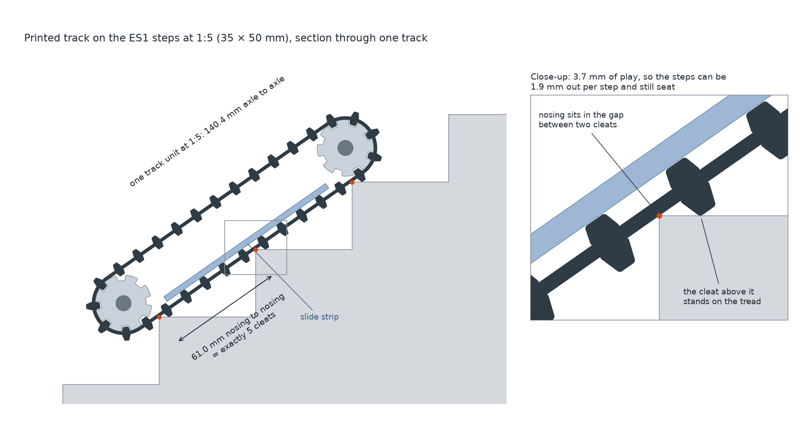
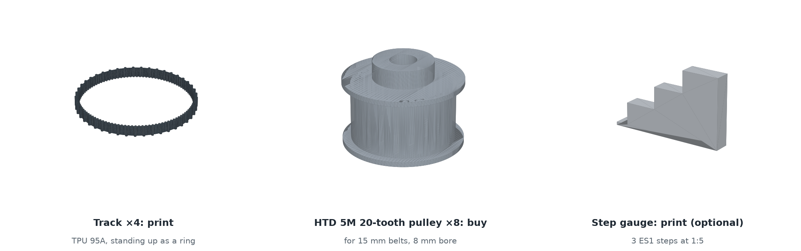
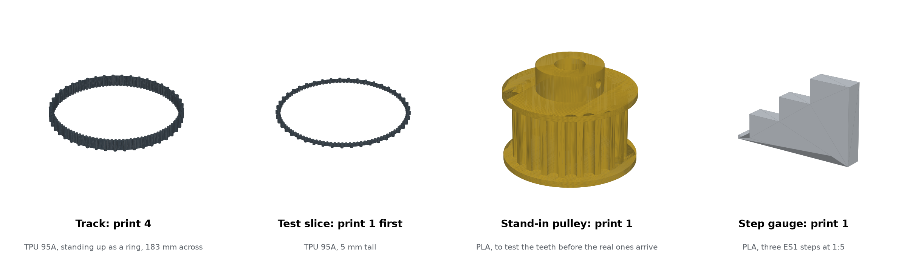

# Printable track for the 1:5 prototype

> **21 Oct 2026: the team is buying the track.** Nhien and Nazim chose bought HTD 550-5M-15 belts with 22 cleats,
> cut to 5 mm and bonded by the belt maker (drawing TS-01B). The printed track below is kept as the fallback.
> Start at `START_HERE.md`.

A 3D-print file for the tracks of the team's 1:5 base: two track segments, 225 mm axle to
axle (45 cm in all, 1.125 m segments at full size), each with a 550 mm track loop on wheels
about 1.5 cm in radius. The track is printed; the pulleys are bought.







## How it fits the team's base

- **Bought pulleys:** HTD 5M, 20 teeth (31.8 mm pitch diameter, so about 1.5 cm to the track),
  for 15 mm belts, 8 mm bore. The track has 110 HTD 5M teeth inside, so its loop is 550 mm, and
  (550 − 100) / 2 puts the axles exactly 225 mm apart.
- **Segment length:** run in the simulator (`../track_sim`), 1.125 m segments (22.5 cm at 1:5)
  stop, bend and go over the ES1 stairs as well as the 0.70 m ones did: 14.5° of lean before
  tipping going down and 18° going up, the hinge bending 35° up and 37° down, and no drop at any
  edge. A stiff 2.25 m track tips at the edges, one end dropping up to 48 cm.

## Matched to the ES1 steps

The ES1 steps, measured at 175 × 250 mm, are 35 × 50 mm at 1:5, so their edges are 61.03 mm
apart along the slope. The track has 45 cleats round its 550 mm loop, 12.22 mm apart: five of
them span 61.11 mm, within 0.08 mm of a step. When the track lies on a flight, every step edge
under it (four under each segment) sits in a gap between two cleats, and the cleat above each
edge stands on that step. Every step in contact holds the track, like a gear on a rack, instead
of the track riding on cleat tips.

`generate_track.py` checks this by sliding the track along the flight:

| Cleat spacing | Four step edges under one segment |
|---|---|
| 11.2 mm (the full-size plan's 56 mm, at 1:5) | can't all sit in gaps |
| **12.22 mm (5 per step)** | **all sit in gaps, with 3.5 mm of play** |
| 13.0 mm | can't all sit in gaps |

The play lets each test step be about 1.2 mm out. With every step 1 mm deeper or shallower
(51 or 49 mm) it still seats, with about 1 mm of play. On the brief's 170 × 280 mm steps
(34 × 56 mm), it doesn't. **Build the 1:5 test stairs at 35 mm high and 50 mm deep**, or
regenerate the file for your stairs (below).

The cleats are 3 mm tall (15 mm at full size). Holding still on a flight needs a grip
(friction coefficient) of 0.61, and a hard stop going down 0.76; the TPU and the cleats provide
it.

## Files (`stl/`)

| File | Print | Qty | Notes |
|---|---|---|---|
| `track_TPU_x4.stl` | TPU 95A | 4 | 183 mm ring, 15 mm tall, about 32 g. Needs a bed at least 190 mm across |
| `fit_test_track_5mm_TPU.stl` | TPU 95A | 1 | A 5 mm slice of the track. Print it first and try it on a pulley |
| `step_gauge_3_steps_1-5_PLA.stl` | PLA | 1 | Optional: three ES1 steps at 1:5 to try a track on by hand |
| `stand_in_pulley_20T_PLA_test_only.stl` | PLA | 1 | A copy of the bought pulley to check the teeth mesh before the real ones arrive. Test only, not for driving. The top flange overhangs 2.5 mm: most printers bridge it, or turn supports on. M3 set screw in the hub |

`stl/track.json` lists every dimension and the check results.

**Print settings:** TPU 95A on a direct-drive extruder (Bambu, Prusa MK3/MK4 and similar). Print
the track as it is, standing up as a ring, with no supports, 0.2 mm layers, 20–30 mm/s and 100%
infill. The belt is pulled and bent along its layers, its strongest direction. The NUS Library
printer only prints PLA, so print the tracks on a printer that takes TPU or ask one of the 3D
printing services on the vendor list.

## Buy

- 8 × HTD 5M 20-tooth pulleys for 15 mm belts, 8 mm bore, with flanges (2 per segment per side).
- 8 mm steel rod for the 3 axles, 8 KFL08 flange bearings.
- All three from MISUMI Singapore, which is on the approved vendor list.
- Slide strips under each track's lower run: the teeth ride on them, so their top face sits
  13.3 mm below the axle centres. They run between the pulleys, about 185 mm long.

If the printed teeth skip on the pulleys, a stock 550-5M-15 belt (110 teeth) fits the same
pulleys and axle spacing; the cleats can then be printed as strips and glued on.

## Assembly

1. Print the fit-test slice. Check that its teeth drop into a pulley's grooves and that it wraps
   the pulley without riding up. Then print the four tracks.
2. Cut the end axles' holes in the side plates as slots about 3 mm long, and the same for the
   KFL08 bolt holes. Slide each end axle in to fit the track, then out to tension it. The tracks
   stretch a little when new, so check and re-tension after the first runs.
3. Line each pulley up with its lane with a straight edge, then tighten its set screws. File a
   flat on the middle axle under its set screws: it drives.
4. Try a track on the step gauge or the test stairs. Push the segment down the slope by hand: it
   should settle with a cleat standing on each tread.

## Assembly drawings (`assembly/`)

Everything for one track segment, drawn from `assembly/parts_spec.json` (the single source of
numbers, mm at 1:5). `drawings/`:

| Sheet | What it shows |
|---|---|
| `exploded_segment.png` | the front segment pulled apart along the axle, z stations, and every screw depth |
| `part_track.png` | the track ring and belt section |
| `part_pulley.png` | the bought HTD 5M 20T pulley and its order spec |
| `part_axle.png` | the three axles and what sits where on each |
| `part_side_plate.png` | the printed plate with its slide rail, both variants |
| `part_bearing_and_fasteners.png` | 608ZZ and its pocket, cross bars, every fastener |
| `motion_and_drive.png` | what turns on which shaft, and how the segments link to the drive motor, the hinge motor and the box |

CAD-style A3 sheets (`eng_sheets.py`, template `eng_sheet.py`): monochrome, true scale, third angle,
title block, parts list and balloons on the assembly:

| Sheet | DWG NO. |
|---|---|
| `TS-00_assembly_front_segment.png` | front segment: top, side and end views, balloons 1-9, parts list |
| `TS-01_track.png` | track ring 1:1, edge view, belt section 4:1 |
| `TS-02_side_plate_front.png`, `TS-03_side_plate_rear.png` | top and front views 1:1, sections A-A and B-B 2:1, sector holes detail |
| `TS-04_axles.png` | the three axles and the hinge cross shaft, flats detail 4:1 |
| `TS-05_spacer.png` | cross bar spacers 82 and 210 |
| `TS-06_pulley_20T.png` | bought HTD 5M 20T pulley: front view and section 2:1, order spec |
| `TS-07_bearing_608ZZ.png` | bought 608ZZ: front view, section, fitted in the plate pocket |
| `TS-08_rear_segment_to_base.png` | cut through the middle axle (box, hinge gear, plates, pulleys, tracks side by side), cut through a rear cross bar (track on rail, box clamped between the plates), side view of the rear segment on the box |

`buy_vs_make.md` lists every part with where to get it. `generate_frame.py` makes the plate and
spacer print files (`stl/side_plate_*.stl`, `stl/spacer_front_x2.stl`, `stl/spacer_rear_x4.stl`) from the spec.

Layout (v2): per side from the centre line, box to 40 | front plate 41-48 | front track 49-69 |
rear track 77-97 | rear plate 105-112; 194 mm over the tracks. Bearings are 608ZZ pressed into
the plates; axles 230 / 230 / 160 mm; the box must stop at z 37 near the middle axle for the
hinge sector gear.

## Other stairs

```bash
pip install manifold3d trimesh numpy matplotlib shapely
python3 generate_track.py --rise 34 --going 56   # your test stairs' step, at model size (mm)
python3 preview_track.py                         # redraws preview/
```

The cleat count becomes the nearest to five per step round the 550 mm loop. Every value
(belt teeth, pulley teeth, cleat size, track width) is in the `Design` dataclass at the top of
`generate_track.py`. Every file is checked to be a single closed solid.

## Buildability and function check, 18 Oct 2026

Measured on the shared model before the build steps were written (full write-up in the manufacturing and
assembly plan document):

- Hinge sector travel: the sector spans 31.4° behind to 42.3° ahead of vertical and the pinion sits 10.4°
  ahead (centre x 11, y 60), so 41.8° of teeth lie behind the pinion; less 5 to 7° to keep 1.5 teeth in
  mesh that is 35 to 37° of nose-down travel against the 35° stair pitch. Ask Nhien for two more teeth at
  the rear end (+7°) and 3 mm more slot H toward the rear.
- Cross pins: the shaft cannot go to the drill press with its pulleys on (they sit between the plates), so
  the hub holes are drilled on the press when the pulleys are bored and the shaft is drilled through them
  in place at assembly. TS-06, EX-06, the viewer texts and the pack's feasibility and build-day pages say so.
- Everything else of the 16 Oct feasibility check stands: buildable with the Professional Workshop and the
  Fab Lab; it works as a 1:5 demonstrator of the ES1 descent once the review changes are in.
- TS-09 and TS-10 corrected 18 Oct while building the CAD copy: the tab is 30 long with leg B 1.5 mm off the slot end
  and its M3 hole at (+-223, +11); the slider is an 8 mm slice of the same angle with an 8 mm foot that the jack screw
  pushes (the old flat slider sat 1 mm below the jack's axis); the carrier angles' plate legs are 6.5, not 8, so the
  upper and lower angles clear each other, with six new M3 holes per plate at y +-3.5. `cad/RB4107_track_unit_reviewed.step`
  carries all of it, interference-checked.
- Pulley to shaft, settled 18 Oct after Nhien's notes and the reviewer's set-screw advice: the hinge wheels stay pinned,
  because they fill the 20 mm lane at 19 over the flanges and have no hub for a set screw (it would sit under the
  track); the stage-2 pulley M3 may keep its set screw if it is a cone point into a seat spot-drilled in the shaft
  through the hub hole, with Loctite 243; a set screw on the plain round shaft (friction only) and a D-flat are both
  out. Plan Appendix C item 17.
- Hinge sector gear, proposed: buy a KHK SSAY1-100 (module 1, 100 teeth, 6 mm S45C plate) and cut a 23-tooth sector
  from it with the P14 holes drilled first on the whole gear; pitch radius 50 instead of 51, so the pinion centre
  distance becomes 60.1 to 60.2 or the pinion becomes 22 teeth. Plan section 5.14 and Appendix C item 16, pending
  Nhien's OK.
- Rail screws corrected 18 Oct (found when the fasteners were added in Fusion): 3 x 5 thread-forming into blind
  pilots 4 deep, not 3 x 10; the rail is 5 thick and its far face carries the track. The 24 carrier M3 x 6 and the
  4 tab M3 x 6 are listed in the brief and the procurement list; none of these 52 screws are in the STEP.
- Rail screw positions settled 19 Oct: 20, 93, 166 from the rail's hinge end (x 38, 111, 184), 7.5 from the plate
  face, not at the plate screws' x (TS-10 redrawn). Do not drill the old clip pilots in the rails: they overlap the
  new ones at x 38 / 40 and 184 / 185.
- Stage-2 pulley, 20 Oct: no cross pin after all (drilling through its small toothed part is fiddly). It becomes a MISUMI
  HTD 5M pulley for the 9 mm belt with a hub, bore 8, held by two cone-point set screws in seats drilled 1 mm into
  the shaft, Loctite 243. The hub makes each hinge shaft longer by its length (to confirm with Nhien). The hinge
  wheels keep their 2.5 x 24 pins. TS-06, TS-11, TS-12 and procurement 1C updated.
